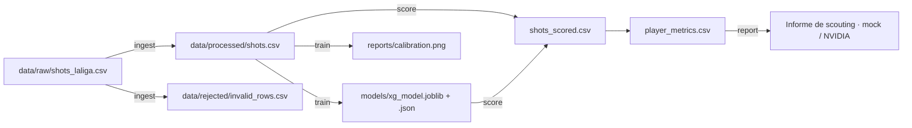
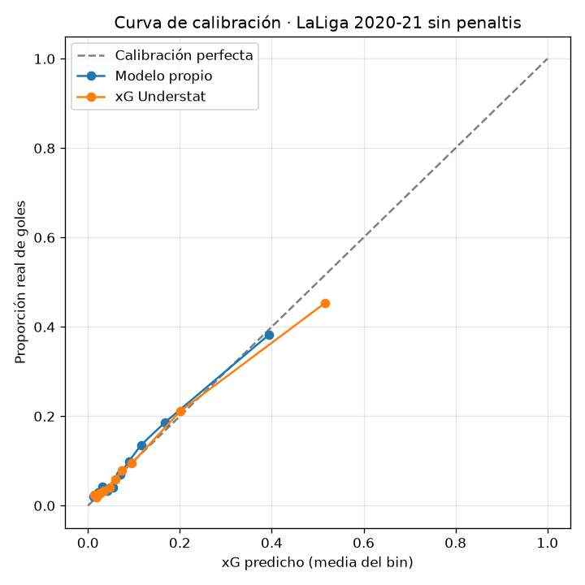
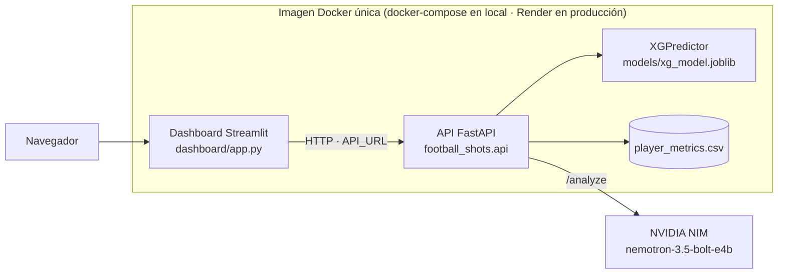

# ShotIQ · Expected goals de LaLiga con informes de scouting por IA


Proyecto de la asignatura *Desarrollo de Soluciones de IA* (máster, curso 2026-27).

A partir de los tiros de LaLiga (temporadas 2019-20 y 2020-21) se construye un pipeline que:

1. **valida** los datos con un contrato Pydantic (Proyecto I);
2. **entrena un modelo propio de expected goals (xG)** con scikit-learn y lo compara con el xG de Understat;
3. **puntúa** cada tiro y calcula **métricas por jugador** (goles, xG, npxG, goles − xG…);
4. genera un **informe de scouting con IA generativa** (LLM de NVIDIA);
5. lo sirve todo con una **API FastAPI** y un **dashboard Streamlit**, en contenedores Docker y desplegado en Render (Proyecto III).

| Entrega | Contenido | Tag |
|---|---|---|
| Proyecto I | loader, validator, metrics, CLI, tests y CI | — |
| **Proyecto II** | ingesta, features, entrenamiento, evaluación, scoring, métricas por jugador, IA generativa | `v0.2.0` |
| **Proyecto III** | API FastAPI + dashboard Streamlit + Docker + Render (amplía este mismo repo) | `v1.0.0-rc` / `v1.0.0` |

**Demo en vivo:** [dashboard](https://shotiq-dashboard.onrender.com) · [API (`/docs`)](https://shotiq-api.onrender.com/docs). Están en el plan gratuito de Render: si llevan un rato sin uso, tardan ~1 min en despertar.

El diseño completo (diagramas, decisiones y limitaciones) está en [`docs/ARQUITECTURA.md`](docs/ARQUITECTURA.md).

---

## Dataset

**Football Shots Dataset: Top 5 European Leagues**, publicado en Kaggle.

- **URL de origen:** https://www.kaggle.com/datasets/mat126/shots-dataset-for-footballsoccer
- **Fuente original de los datos:** Understat (https://understat.com)
- **Fichero utilizado:** `shots_dataset_cleaned.csv` (completo, no se sube al repo) y `data/raw/shots_laliga.csv` (muestra: LaLiga, temporadas 2019 y 2020)
- **Fecha de descarga:** 5 de octubre de 2026
- **Licencia:** Database Contents License (DbCL) v1.0
- **Condiciones de uso:** uso educativo y no comercial; los datos proceden de Understat.

### Por qué este dataset

El xG (*expected goals*) es la métrica más usada en el análisis de fútbol: la probabilidad de que un tiro acabe en gol según cómo y desde dónde se hace. Entrenar un xG propio es un problema de clasificación real, con un benchmark público para compararse (el xG de Understat) y una aplicación directa: saber qué jugadores marcan más o menos de lo que deberían por la calidad de sus ocasiones. Ese es el producto que se servirá en el Proyecto III.

### Descripción

El dataset contiene los tiros de las cinco grandes ligas europeas entre 2014/15 y 2020/21. Cada fila es un tiro con su posición (coordenadas X e Y normalizadas entre 0 y 1), el contexto de la jugada, el resultado y el xG de Understat.

El CSV completo (~400.000 filas) es demasiado grande para GitHub, así que en el repo solo está `data/raw/shots_laliga.csv`: **LaLiga, temporadas 2019 y 2020**, con las columnas seleccionadas y renombradas. No se han eliminado duplicados ni errores al generarla: de eso se encarga el pipeline.

- **Registros (muestra):** 20.832, de los que 4.704 son `shot_id` duplicados → **16.128 tiros únicos**
- **Columnas:** 19
- **Valores nulos:** 2.436 (todos en `last_action`)
- **Variable objetivo:** `is_goal`

<details>
<summary>Diccionario de variables</summary>

| Variable | Descripción |
|---|---|
| `shot_id` | Identificador único del tiro |
| `match_id` | Identificador del partido |
| `date` | Fecha y hora del partido |
| `season` | Temporada (año de inicio): 2019 o 2020 |
| `league` | Liga (siempre `Liga`, LaLiga) |
| `h_team` | Equipo local |
| `a_team` | Equipo visitante |
| `h_a` | Si el tirador juega en casa (`h`) o fuera (`a`) |
| `player` | Nombre del jugador que tira |
| `player_id` | Identificador del jugador |
| `minute` | Minuto del partido en que se produce el tiro (0–100) |
| `x` | Coordenada horizontal del tiro, normalizada 0–1 (1 = línea de gol rival) |
| `y` | Coordenada vertical del tiro, normalizada 0–1 (ancho del campo) |
| `situation` | Contexto de la jugada: `OpenPlay`, `FromCorner`, `SetPiece`, `DirectFreekick`, `Penalty` |
| `shot_type` | Parte del cuerpo con la que se tira: `RightFoot`, `LeftFoot`, `Head`, `OtherBodyPart` |
| `last_action` | Acción previa al tiro (pase, centro, regate…); 28 categorías, con nulos |
| `preferred_foot` | Pie dominante del jugador |
| `xg_understat` | Goles esperados (xG) que asigna Understat al tiro (0–1) |
| `is_goal` | **Variable objetivo**: 1 si el tiro acaba en gol, 0 si no |

</details>

---

## Instalación

Requiere Python 3.12 y [uv](https://docs.astral.sh/uv/).

```bash
uv sync                      # crea .venv con las dependencias
cp .env.example .env         # configuración: añade tu NVIDIA_API_KEY
```

Sin uv: `python -m venv .venv`, activar el entorno y `pip install -r requirements.txt`.

---

## Pipeline del Proyecto II



```bash
uv run python -m football_shots.cli ingest     # valida y separa válidos / rechazados / duplicados
uv run python -m football_shots.cli train      # elige modelo, entrena, evalúa y guarda
uv run python -m football_shots.cli score      # xG de cada tiro + métricas por jugador
uv run python -m football_shots.cli run        # los tres pasos anteriores seguidos

uv run python -m football_shots.cli report --player Benzema                 # temporada 2020 por defecto
uv run python -m football_shots.cli report --player-id 2097 --season 2019   # Messi 2019-20
uv run python -m football_shots.cli report --player Benzema --provider nvidia
```

Todas las rutas se pueden cambiar con opciones (`--help` en cada comando) o con variables de entorno (`.env`). Cada paso escribe logs con los conteos y métricas (`--log-level DEBUG` para más detalle).

El modelo entrenado (`models/`) y la curva de calibración (`reports/`) **están en el repo**, así que `score` funciona sin reentrenar. Las salidas de `data/processed/` y `data/rejected/` se regeneran con `run` (≈10 s) y no se suben.

El comando del Proyecto I sigue disponible: `uv run python -m football_shots.cli` (equivale a `summary`).

### 1. Ingesta

| Paso | Resultado |
|---|---|
| Filas cargadas | 20.832 |
| Duplicados por `shot_id` (se cuentan aparte, no son errores) | 4.704 |
| Rechazadas por el contrato `ShotRecord` (se guardan con el motivo) | 0 |
| **Tiros válidos** | **16.128** |

### 2. Features

Solo variables que **describen el tiro**, nunca a quién tira (así goles − xG es comparable entre jugadores):

| Feature | Tratamiento |
|---|---|
| `distance` a la portería (m) | numérica, escalada |
| `angle` de visión entre los postes (rad) | numérica, escalada |
| `minute` | numérica, escalada |
| `situation`, `shot_type` | one-hot |
| `last_action` | vacíos → `"None"`; one-hot agrupando las categorías raras |

Las coordenadas se convierten a metros sobre un campo de 105 × 68 m (fórmulas en `docs/ARQUITECTURA.md`). La geometría, el preprocesado y el modelo van en **un único `Pipeline`** de scikit-learn, guardado con joblib.

### 3. Entrenamiento y evaluación

- **Split temporal:** entrenamiento con 2019-20 y test con 2020-21 (predecir la temporada siguiente).
- **Penaltis aparte:** su xG es la tasa de conversión en train, `penalty_xg = 0,832` (149 penaltis).
- **Selección de modelo:** `GroupKFold` (5 pliegues por partido) dentro de 2019, log loss como métrica:

| Candidato | Log loss CV |
|---|---|
| **Regresión logística, C = 1** ✅ | **0,2616** |
| Regresión logística, C = 10 | 0,2617 |
| Regresión logística, C = 0,1 | 0,2623 |
| HistGradientBoosting (lr 0,03, profundidad 4) | 0,2640 |
| HistGradientBoosting (lr 0,05, 15 hojas) | 0,2679 |

Con 8.000 tiros y features ya muy informativas (distancia y ángulo), el modelo lineal generaliza mejor que el boosting.

**Test 2020-21 sin penaltis (7.673 tiros, evaluación única):**

| Métrica | Sin modelo (tasa media) | **Modelo propio** | xG Understat |
|---|---|---|---|
| Log loss ↓ | 0,3342 | **0,2833** | 0,2620 |
| Brier ↓ | 0,0933 | **0,0810** | 0,0752 |
| ROC-AUC ↑ | 0,5000 | **0,7769** | 0,8134 |
| xG total vs 798 goles reales | — | **766,7** | 833,6 |

El modelo mejora mucho al baseline y se queda cerca de Understat, que usa información que este dataset no tiene. La suma de xG del modelo queda más cerca de los goles reales que la de Understat.



### 4. Scoring y métricas por jugador

`score` añade `xg_model` y `xg_source` (`model` o `penalty_rule`) a cada tiro y agrega por jugador y temporada: `shots`, `np_shots`, `goals`, `np_goals`, `xg`, `npxg`, `xg_understat`, `goals_minus_xg`, `np_goals_minus_npxg`, `npxg_per_shot` e `in_sample` (true en 2019, la temporada de entrenamiento).

Mayor diferencia entre goles sin penalti y npxG en 2020-21:

| Jugador | Goles sin penalti | npxG | Diferencia |
|---|---|---|---|
| Marcos Llorente | 12 | 4,01 | +7,99 |
| Morales | 14 | 6,05 | +7,95 |
| Karim Benzema | 22 | 15,09 | +6,91 |
| Lionel Messi | 27 | 22,53 | +4,47 |
| Lucas Ocampos | 1 | 6,84 | −5,84 |

### 5. IA generativa

`report` genera un informe de scouting de un jugador a partir de sus métricas.

- **Proveedor:** LLM `nvidia/nemotron-3.5-bolt-e4b`, servido por [NVIDIA NIM](https://build.nvidia.com) (API compatible con OpenAI). Es el que trae configurado `.env.example` (`GENAI_PROVIDER=nvidia`).
- **Doble de pruebas:** `MockClient` (`GENAI_PROVIDER=mock`) es una plantilla determinista. La usan los tests y el CI: sin red, sin coste y sin secretos. También es el valor por defecto si no hay `.env`.

Para usar NVIDIA, crea una API key gratuita en build.nvidia.com (empieza por `nvapi-`) y ponla en `.env` como `NVIDIA_API_KEY=nvapi-...`.

El *system prompt* obliga al LLM a:
- usar **solo las cifras recibidas**;
- distinguir xG de npxG;
- avisar de que no hay minutos jugados y de cuándo la temporada es in-sample.

Los errores del proveedor se convierten en `GenAIError` o `GenAITimeoutError`; el timeout se configura con `GENAI_TIMEOUT_S`. La API los traduce a 502 / 504.

```bash
uv run python -m football_shots.cli report --player Benzema
```

Ejemplo de informe con NVIDIA:

```text
Karim Benzema (id 2370) en 2020-21 (LaLiga) presenta 123 tiros (122 sin penaltis) y 23 goles (22 sin penaltis).
El xG del modelo es 15.93 y npxG es 15.09. El npxG por tiro es 0.124. No hay minutos jugados, por lo tanto,
no se presentan métricas por 90 minutos. El modelo no se entrenó con esta temporada.

Su eficacia de cara a puerta es superior a la esperada por el modelo.
```


---

## Estructura

```text
src/football_shots/
  config.py      # rutas, .env y logging
  loader.py      # carga del CSV                     (Proyecto I)
  validator.py   # contrato Pydantic ShotRecord      (Proyecto I)
  ingesta.py     # duplicados + validación + ficheros de salida
  features.py    # distancia, ángulo y preprocesado
  train.py       # select_model (CV) + fit_pipeline + run_training
  evaluate.py    # log loss, Brier, ROC-AUC y curva de calibración
  predictor.py   # XGPredictor: ruta modelo y ruta penalti
  metrics.py     # métricas del Proyecto I + métricas por jugador
  genai.py       # MockClient + NvidiaClient
  cli.py         # summary · ingest · train · score · report · run
  api/
    main.py        # create_app(): middleware, handlers de error y endpoints
    schemas.py     # modelos Pydantic de entrada y salida
    monitoring.py  # MetricsStore: contadores, latencias y últimas peticiones
dashboard/
  app.py         # Streamlit: 3 pestañas (tiro · jugador + IA · operación)
  api_client.py  # cliente HTTP de la API (solo usa API_URL)
tests/
  fixtures/shots_mini.csv   # 50 tiros reales para entrenar un modelo mini
  test_*.py                 # un fichero por módulo (test_api.py para la API)
scripts/smoke_test.sh       # smoke test de la API desplegada
data/raw/        # muestra de datos (en el repo)
models/          # modelo entrenado + metadatos (en el repo)
reports/         # curva de calibración
docs/            # arquitectura
Dockerfile · docker-compose.yml · render.yaml
```

---

## Tests

```bash
uv run pytest -q                       # todos (149 tests)
uv run pytest -q -m "not integration"  # sin los que leen el CSV real
uv run pytest -q --cov=football_shots --cov-report=term-missing --cov-fail-under=60
```

- Cobertura actual: **99 %**.
- Los tests del modelo usan una fixture (`conftest.py`) que entrena un **modelo mini** con `fit_pipeline` sobre `tests/fixtures/shots_mini.csv`, así que no dependen del `.joblib` de `models/` ni se rompen al reentrenar.
- Las dos rutas del predictor (modelo y penalti), la CLI de extremo a extremo y el cliente NVIDIA (con un cliente falso, sin red) tienen tests propios.
- La IA se prueba siempre con el mock o con clientes falsos: tests deterministas, sin coste y sin secretos.
- La API se prueba con `TestClient` sobre `create_app(...)`, inyectando el modelo mini, un `player_metrics.csv` temporal y clientes de IA falsos que simulan timeouts y errores.

## CI

GitHub Actions (`.github/workflows/ci.yml`) se ejecuta en cada push a `main` y en cada pull request, con dos jobs:

1. **test:** pytest con el umbral de cobertura del 60 %, con `GENAI_PROVIDER=mock`.
2. **docker** (si `test` pasa): construye la imagen, arranca la API en modo mock, espera a `/health` y ejecuta `scripts/smoke_test.sh`.

El CI nunca usa secretos ni llama a NVIDIA.

---

## Proyecto III · API, dashboard y despliegue

El núcleo de los Proyectos I y II no cambia: la API lo reutiliza (`XGPredictor`, `player_metrics.csv`, `find_player`, `genai`) y el dashboard solo habla con la API por HTTP.



### Endpoints

| Método y ruta | Qué hace | Errores |
|---|---|---|
| `GET /health` | Estado y checks (`model_loaded`, `player_metrics_loaded`, `genai_configured`). Nunca llama al LLM | 503 si está `degraded` |
| `POST /predict` | xG de un tiro (`source`: `model` o `penalty_rule`) | 400, 503 |
| `GET /players?season=2020&min_shots=1` | Jugadores de una temporada, ordenados por tiros | 503 |
| `GET /players/{player_id}/metrics?season=2020` | Métricas de un jugador | 404 |
| `POST /analyze` | Informe de scouting con IA del jugador | 404, 502, 503, 504 |
| `GET /metrics` | Métricas de operación en memoria | — |

La documentación interactiva está en `/docs`.

```bash
curl -X POST http://localhost:8000/predict -H 'Content-Type: application/json' \
  -d '{"x": 0.8952, "y": 0.5, "minute": 45, "situation": "OpenPlay", "shot_type": "RightFoot", "last_action": "Pass"}'
# {"xg": 0.2426, "source": "model", "request_id": "..."}

curl -X POST http://localhost:8000/analyze -H 'Content-Type: application/json' \
  -d '{"player_id": 2518, "season": 2020}'
# {"player_id": 2518, "season": 2020, "report": "...", "provider": "nvidia", "model": "nvidia/nemotron-3.5-bolt-e4b", "latency_ms": ..., "request_id": "..."}
```

### Arranque en local con uv

Hacen falta `data/processed/player_metrics.csv` (con `ingest` y `score`) y un `.env` con la key de NVIDIA.

```bash
uv run python -m football_shots.cli ingest && uv run python -m football_shots.cli score
```

Terminal 1, la API (en http://localhost:8000/docs):

```bash
uv run uvicorn football_shots.api.main:app --port 8000
```

Terminal 2, el dashboard (en http://localhost:8501):

```bash
uv run streamlit run dashboard/app.py
```

Sin API key: `GENAI_PROVIDER=mock uv run uvicorn football_shots.api.main:app --port 8000`.

### Arranque con Docker

```bash
docker compose up --build
```

- Dashboard: http://localhost:8501
- API: http://localhost:8000/docs

La imagen es la misma para los dos servicios. En el build se regenera `data/processed` (no se entrena: se usa el modelo del repo) y se ejecuta con un usuario sin privilegios. Compose lee `.env` si existe.

El dashboard espera a que `/health` esté en verde. Sin key de NVIDIA, la API sale `degraded`; para probar sin key, usa `GENAI_PROVIDER=mock docker compose up --build`.

### Monitorización

- **`/health`** devuelve `status: ok` o `degraded`, los checks y el motivo de los que fallan (`details`). Si alguno falla responde **503**, así que Render y docker-compose lo detectan.
- **`/metrics`**, en memoria (un worker), devuelve:
  - uptime;
  - por ruta: peticiones, errores 4xx/5xx, % de errores y latencia p50/p95;
  - la latencia del LLM medida aparte, con llamadas y fallos;
  - las últimas 20 peticiones;
  - la información del modelo (entrenamiento y métricas de test frente a Understat).
  
  No cuenta sus propias peticiones.
- **`request_id`:** cada petición recibe un id que aparece en la cabecera `X-Request-ID`, en la línea de log (`request request_id=… method=… path=… status=… latency_ms=…`; nivel INFO si va bien, WARNING en los 4xx y ERROR en los 5xx), en el cuerpo de los errores y en el dashboard. Con él se encuentra en los logs cualquier error que vea el usuario.

La pestaña **Operación** del dashboard muestra todo esto.

### Errores

Todas las respuestas de error tienen la forma `{"error": "...", "request_id": "..."}`.

| Código | Cuándo |
|---|---|
| 400 | Entrada inválida (campo fuera de rango, categoría desconocida, JSON mal formado). Se sustituye el 422 por defecto de FastAPI |
| 404 | Jugador inexistente en esa temporada, o ruta inexistente |
| 500 | Error inesperado. Mensaje genérico (`Error interno`), sin traza. El detalle queda en el log con el `request_id` |
| 502 | El proveedor de IA devolvió un error |
| 503 | Servicio no disponible: falta el modelo o las métricas, o la IA no está configurada (sin `NVIDIA_API_KEY`) |
| 504 | El proveedor de IA superó el timeout (`GENAI_TIMEOUT_S`) |

### Despliegue

Render, con dos Web Services Docker definidos en `render.yaml`:

1. **Build:** Render construye el `Dockerfile` del repo (rama `main`). En local: `docker build -t shotiq .`
2. **Variables de entorno:**
   - En `shotiq-api`: `NVIDIA_API_KEY` (a mano en el panel de Render; nunca en el repo). El resto ya viene en `render.yaml`: `GENAI_PROVIDER=nvidia`, `NVIDIA_MODEL`, `NVIDIA_BASE_URL`, `GENAI_TIMEOUT_S` y `LOG_LEVEL`.
   - En `shotiq-dashboard`: `API_URL` con la URL pública de `shotiq-api`.
3. **Arranque:**
   - `shotiq-api` usa el `CMD` de la imagen (`uvicorn` en `$PORT`).
   - `shotiq-dashboard` usa `sh scripts/start_dashboard.sh` (Streamlit en `$PORT`).
   - Render comprueba `shotiq-api` con `/health`.
4. **Smoke:**

   ```bash
   scripts/smoke_test.sh https://shotiq-api.onrender.com
   ```

   Con `SMOKE_ANALYZE=1` delante, también prueba `/analyze` (gasta una llamada al LLM).
5. **Rollback:** `git checkout <tag anterior>` (p. ej. `v1.0.0-rc`) y redeploy en Render de ese commit (*Manual Deploy → Deploy a specific commit*), o revertir el commit en `main`.

Pasos en Render: *New → Blueprint →* elegir este repo, rellenar `NVIDIA_API_KEY` en `shotiq-api`, desplegar, copiar su URL en `API_URL` de `shotiq-dashboard` y redesplegar el dashboard.

| Servicio | URL |
|---|---|
| API (`shotiq-api`) | https://shotiq-api.onrender.com · documentación interactiva en [`/docs`](https://shotiq-api.onrender.com/docs) |
| Dashboard (`shotiq-dashboard`) | https://shotiq-dashboard.onrender.com |

El plan gratuito de Render se duerme tras ~15 min sin uso y tarda ~1 min en despertar: abre las URLs unos minutos antes de usarlas.

---

## Fuente

Football Shots Dataset: Top 5 European Leagues. Kaggle (mat126). Datos de Understat.
