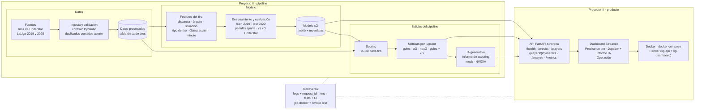

# Arquitectura del proyecto xG

Proyecto de máster · Desarrollo de Soluciones de IA (Python)
Modelo de expected goals (xG) con datos de Understat + informes de scouting con IA generativa.

| Entrega | Fecha | Tag |
|---|---|---|
| Proyecto II (pipeline) | 12 nov | `v0.2.0` |
| Proyecto III · Release Candidate | 23 nov | `v1.0.0-rc` |
| Proyecto III · exposición (5-7 min) | 30 nov | `v1.0.0` |

## Índice

1. [Alcance](#1-alcance)
2. [Diagrama general](#2-diagrama-general)
3. [Etapas](#3-etapas)
4. [Decisiones de diseño](#4-decisiones-de-diseño)
5. [Limitaciones](#5-limitaciones)
6. [Estructura del repositorio](#6-estructura-del-repositorio)
7. [Plan de entregas](#7-plan-de-entregas)
8. [Trabajo futuro](#8-trabajo-futuro)

---

## 1. Alcance

- **Datos:** CSV de tiros de Understat (`data/raw/shots_laliga.csv`), LaLiga, temporadas `2019` (2019-20) y `2020` (2020-21). Son 20.832 filas, de las que 4.704 son duplicados (22,6 %).
- **Proyecto II:** ingesta, features, entrenamiento, evaluación, scoring por CLI, métricas por jugador y cliente de IA generativa (LLM de NVIDIA NIM como proveedor real; `MockClient` como doble de pruebas), con logs y tests.
- **Proyecto III:** API FastAPI síncrona (`/health`, `/predict`, `/players`, `/players/{id}/metrics`, `/analyze`, `/metrics`) y dashboard Streamlit de una página con tres pestañas (producto y operación) que consume la API. Imagen Docker única, docker-compose en local, despliegue en Render, smoke test y job de Docker en el CI.
- **Fuera de alcance (trabajo futuro):** `/analyze` asíncrono y detección de deriva del xG servido.

---

## 2. Diagrama general

Vista conceptual. El detalle de cada bloque está en la sección 3.



---

## 3. Etapas

Todo el sistema es síncrono. Las etapas del Proyecto II se ejecutan en batch desde la CLI (`ingest`, `train`, `score`). Las del Proyecto III responden a peticiones HTTP. Los logs usan `logging` de la stdlib, configurado en `config.py`.

### 3.1 Ingesta · Proyecto II

| Fichero | Entrada | Salida | Tecnología |
|---|---|---|---|
| `loader.py` (ya existe) | `data/raw/shots_laliga.csv` | DataFrame crudo | pandas |
| `validator.py` (ya existe) | DataFrame crudo | Filas válidas e inválidas (con motivo) | Pydantic v2 (`ShotRecord` y sus `Literal`) |
| `ingesta.py` | Ruta del CSV | `data/processed/shots.csv`, `data/rejected/invalid_rows.csv` | pandas |

- **Inválidos:** se guardan con el motivo del error de Pydantic. No hay umbral de rechazo.
- **Duplicados:** se eliminan por `shot_id` y se cuentan aparte (4.704 de 20.832). No se tratan como errores.
- **Penaltis:** se quedan en `shots.csv`. Se separan en el entrenamiento.
- **Logs:** filas cargadas, duplicados eliminados, filas rechazadas y filas finales.

### 3.2 Features · Proyecto II

| Fichero | Entrada | Salida | Tecnología |
|---|---|---|---|
| `features.py` | DataFrame con `x`, `y`, categóricas | `add_geometry` (distancia y ángulo) y `build_preprocessor` (`ColumnTransformer`) | numpy, scikit-learn |

Conversión de coordenadas (Understat: `x = 1` es la línea de gol rival, `y = 0.5` es el centro; campo de 105 × 68 m):

$$x_m = (1 - x)\cdot 105, \qquad y_m = (y - 0.5)\cdot 68$$

$$X_1 = d = \sqrt{x_m^2 + y_m^2}, \qquad X_2 = \theta = \operatorname{atan2}\!\left(7.32\,x_m,\; x_m^2 + y_m^2 - 3.66^2\right)$$

| Variable | Tratamiento |
|---|---|
| X1 `distance` | numérica (m) |
| X2 `angle` | numérica (rad) |
| X3 `situation` | one-hot: OpenPlay, FromCorner, SetPiece, DirectFreekick |
| X4 `shot_type` | one-hot: RightFoot, LeftFoot, Head, OtherBodyPart |
| X5 `last_action` | vacíos (2.436) → `"None"`; después one-hot con `min_frequency` |
| X6 `minute` | numérica |

Objetivo: `y = is_goal ∈ {0, 1}`.

Fuera del modelo:
- `xg_understat` (solo benchmark).
- Identificadores, equipos, `h_a`, fecha, temporada y `preferred_foot`, porque no describen el tiro.

### 3.3 Entrenamiento y evaluación · Proyecto II

| Fichero | Entrada | Salida | Tecnología |
|---|---|---|---|
| `train.py` | `shots.csv` | `models/xg_model.joblib` (Pipeline completo) + `models/xg_model.json` | scikit-learn, joblib |
| `evaluate.py` | Pipeline + test | Métricas en `xg_model.json`, `reports/calibration.png` | sklearn.metrics, matplotlib |

`train.py` expone dos funciones:
- `select_model(df)`: validación cruzada para elegir el modelo.
- `fit_pipeline(df, config)`: ajuste directo, sin validación cruzada. Es la que usan la fixture de tests y el paso 4.

Protocolo:
1. Split temporal: train = 2019, test = 2020.
2. Se separan los penaltis de train. `penalty_xg` = tasa de conversión de penaltis en train.
3. `select_model` con `GroupKFold` por `match_id` dentro de 2019. Se comparan `LogisticRegression` (baseline) y `HistGradientBoostingClassifier`.
4. `fit_pipeline` con la configuración elegida, sobre todo 2019 sin penaltis.
5. Evaluación única sobre 2020 sin penaltis: log loss (principal), Brier, ROC-AUC y curva de calibración. Las mismas métricas se calculan para `xg_understat` sobre las mismas filas.

`xg_model.json` contiene: features, temporadas de train/test, métricas del modelo y del benchmark, `penalty_xg`, nº de penaltis usados, versión de scikit-learn y fecha.

**Logs:** tamaño de train y test, nº de penaltis y `penalty_xg`, resultado de la validación cruzada por candidato, modelo elegido y métricas finales frente a `xg_understat`.

### 3.4 Scoring y métricas por jugador · Proyecto II

| Fichero | Entrada | Salida | Tecnología |
|---|---|---|---|
| `predictor.py` | Modelo + tiro(s) | xG; ruta penalti (`penalty_xg`) o ruta modelo (`predict_proba`) | scikit-learn, joblib |
| `cli.py` (ya existe) · comando `score` | `shots.csv` + modelo | `data/processed/shots_scored.csv` (columna `xg_model`) | pandas |
| `metrics.py` (ya existe) | `shots_scored.csv` | `data/processed/player_metrics.csv` | pandas |

`PlayerMetrics`, por jugador y temporada:
- Identificación: `player_id`, `player`, `season`.
- Volumen: `shots`, `np_shots`, `goals`, `np_goals`.
- xG: `xg`, `npxg`, `xg_understat`.
- Diferencias y ratio: `goals_minus_xg`, `np_goals_minus_npxg`, `npxg_per_shot`.
- Control: `in_sample` (true en 2019).

**Logs:** tiros puntuados, cuántos van por la ruta modelo y cuántos por la ruta penalti, y nº de jugadores con métricas.

### 3.5 IA generativa · Proyecto II

| Fichero | Entrada | Salida | Tecnología |
|---|---|---|---|
| `genai.py` | `PlayerMetrics` | Informe de scouting (texto) | `MockClient` (plantilla determinista) · `NvidiaClient` (NVIDIA NIM con el SDK de OpenAI, API compatible; timeout configurable) |

- El proveedor real es NVIDIA (`GENAI_PROVIDER=nvidia`, modelo `nvidia/nemotron-3.5-bolt-e4b`), el que trae `.env.example`. `mock` es el doble de pruebas de tests y CI (y el valor por defecto si no hay `.env`). No hay fallback automático de NVIDIA a mock.
- El prompt obliga a usar solo las cifras recibidas, a distinguir xG de npxG y a avisar de que no hay minutos jugados ni de cuándo `in_sample` es true.

### 3.6 API FastAPI · Proyecto III

| Fichero | Contenido | Tecnología |
|---|---|---|
| `api/main.py` | `create_app(model_path, player_metrics_path, genai_client)` y `app = create_app()`. Carga modelo, `player_metrics.csv` y cliente de IA sin tumbar la app si algo falla; middleware de trazabilidad; handlers de error; endpoints | FastAPI, uvicorn |
| `api/schemas.py` | `ShotIn`, `PredictionOut`, `PlayerSummary`, `PlayerMetricsOut`, `AnalyzeIn`, `AnalyzeOut`, `HealthOut`, `MetricsOut` (los alias `Situation` y `ShotType` se importan de `validator.py`) | Pydantic v2 |
| `api/monitoring.py` | `MetricsStore`: contadores, latencias y últimas peticiones en memoria, con un `threading.Lock` | stdlib |

`create_app` recibe sus dependencias para poder probar la API con el modelo mini, un `player_metrics.csv` temporal y clientes de IA falsos.

| Endpoint | Entrada | Salida |
|---|---|---|
| `GET /health` | — | `status` (`ok` \| `degraded`), `checks` (`model_loaded`, `player_metrics_loaded`, `genai_configured`), `genai_provider`, `genai_model`, `version`, `details` |
| `POST /predict` | `{"x", "y", "minute", "situation", "shot_type", "last_action"}` (`minute` por defecto 45, `last_action` opcional) | `{"xg", "source": "model" \| "penalty_rule", "request_id"}` |
| `GET /players` | query `season` (2020), `min_shots` (1) | Lista de `{player_id, player, season, shots, goals}` ordenada por tiros |
| `GET /players/{player_id}/metrics` | path `player_id`, query `season` (2020) | Todas las columnas de `PLAYER_METRICS_COLUMNS` |
| `POST /analyze` | `{"player_id", "season": 2019 \| 2020}` | `{"player_id", "season", "report", "provider", "latency_ms", "request_id"}` |
| `GET /metrics` | — | Uptime, peticiones por ruta (count, errores 4xx/5xx, % de errores, p50/p95), latencia y fallos del LLM, últimas 20 peticiones e información del modelo |

`/players` es nuevo respecto al diseño inicial: lo necesita el desplegable de jugadores del dashboard.

`degraded` significa que algún check falla: no hay modelo, no hay `player_metrics.csv` o la IA no está configurada (por ejemplo, sin `NVIDIA_API_KEY`). En ese caso `/health` responde **503** con el mismo cuerpo, para que Render y docker-compose lo detecten. `/health` nunca llama al LLM.

**Errores:** todos con el cuerpo `{"error", "request_id"}`.

| Código | Cuándo |
|---|---|
| 400 | Entrada inválida. FastAPI devuelve 422 por defecto, así que se registra un handler de `RequestValidationError` que responde 400. |
| 404 | Jugador inexistente en esa temporada, o ruta inexistente. |
| 500 | Error inesperado. Mensaje genérico, sin traza; el detalle va al log con el `request_id`. |
| 502 | El proveedor de IA devuelve un error (`GenAIError`). |
| 503 | Falta el modelo o las métricas, o la IA no está configurada (`GenAIConfigError`). |
| 504 | El proveedor de IA supera el timeout (`GenAITimeoutError`). |

**Logs y trazabilidad:** un middleware genera un `request_id` por petición. Lo devuelve en la cabecera `X-Request-ID` y escribe una línea con `request_id`, método, ruta, estado y `latency_ms`. También registra la petición en `MetricsStore` con la plantilla de ruta (`/players/{player_id}/metrics`), salvo `/metrics`. Los errores no previstos se capturan en el propio middleware para que el 500 también lleve `request_id` y quede contado.

### 3.7 Dashboard · Proyecto III

| Fichero | Contenido | Tecnología |
|---|---|---|
| `dashboard/app.py` | Una página con tres pestañas (`st.tabs`): "Predice un tiro" (entradas en metros, presets de la demo y dibujo del medio campo), "Jugador + informe IA" (`/players`, `/players/{id}/metrics` y `/analyze`) y "Operación" (`/health` y `/metrics`). Estado de la API en la barra lateral | Streamlit, matplotlib |
| `dashboard/api_client.py` | Llamadas a la API con timeouts y `ApiError(status, message, request_id)` | requests |

El dashboard solo conoce `API_URL`. Nunca importa `football_shots` ni lee `data/` o `models/`. Los errores se muestran con su código y su `request_id`.

### 3.8 Transversal

| Fichero | Contenido | Entrega |
|---|---|---|
| `config.py` | Lee `.env` con python-dotenv (`MODEL_PATH`, `DATA_DIR`, `GENAI_PROVIDER`, `NVIDIA_API_KEY`, `NVIDIA_BASE_URL`, `NVIDIA_MODEL`, `GENAI_TIMEOUT_S`, `API_URL`, `LOG_LEVEL`) y configura `logging` | II |
| `.env.example` | Plantilla de variables (`.env` va en `.gitignore`) | II |
| `tests/conftest.py` | Fixture que entrena un modelo mini con `fit_pipeline` sobre `tests/fixtures/shots_mini.csv` y lo guarda en un directorio temporal | II |
| `tests/fixtures/shots_mini.csv` | ~50 tiros de las dos temporadas, con penaltis (alguno en 2019) y al menos 5 goles | II |
| `tests/` | `test_features.py`, `test_predictor.py` (ruta modelo y ruta penalti), `test_genai.py` (mock), `test_api.py` (TestClient + `create_app` con dependencias inyectadas) | II y III |
| `.github/workflows/ci.yml` | Job `test` (pytest con `GENAI_PROVIDER=mock`) y job `docker` (build de la imagen, arranque en modo mock y smoke test) | II y III |
| `requirements.txt` | Dependencias exportadas (ver abajo) | II y III |
| `scripts/smoke_test.sh` | Comprueba `/health` (200 y `ok`), `/predict` (`xg` entre 0 y 1) y `/players`; `/analyze` solo con `SMOKE_ANALYZE=1` | III |
| `Dockerfile` · `.dockerignore` | Imagen única (`python:3.12-slim`, usuario sin privilegios) que regenera `data/processed` en el build; CMD por defecto: la API en `$PORT` | III |
| `docker-compose.yml` | Servicios `api` y `dashboard` con la misma imagen; el dashboard espera a que la API esté sana | III |
| `render.yaml` | Blueprint de Render con dos Web Services Docker: `xg-api` y `xg-dashboard` | III |
| `AI_USAGE.md` | Uso de IA en el desarrollo | II y III |
| `README.md` | Uso de la CLI, métricas del modelo, curva de calibración y sección de despliegue | II y III |

**Dependencias** (se añaden a las que ya usa el paquete, como pandas y Pydantic):

| Proyecto | Dependencias nuevas |
|---|---|
| II | `scikit-learn`, `matplotlib`, `python-dotenv`, `joblib`, `openai` (cliente de NVIDIA NIM) |
| III | `fastapi`, `uvicorn[standard]`, `streamlit`, `requests`; `httpx` en el grupo dev (lo usa `TestClient`) |

`requirements.txt` se genera en cada entrega con:

```bash
uv export --format requirements-txt --no-hashes -o requirements.txt
```

Por defecto `uv export` incluye el grupo dev (pytest). Si solo se quieren las dependencias de producción, se añade `--no-dev`.

**README del Proyecto II (`v0.2.0`):**
- Uso de la CLI: `ingest`, `train`, `score`.
- Tabla de métricas del modelo frente a `xg_understat` en el test 2020 sin penaltis: log loss, Brier y ROC-AUC.
- Curva de calibración (`reports/calibration.png`).

**Despliegue (sección del README, Proyecto III):**
1. **Build:** Render construye el `Dockerfile` (en local: `docker build -t xg-app .` o `docker compose up --build`).
2. **Variables de entorno:** `NVIDIA_API_KEY` a mano en Render (en local, en `.env`); el resto en `render.yaml`. `API_URL` del dashboard con la URL pública de la API.
3. **Arranque:**
   - API: `uvicorn football_shots.api.main:app --host 0.0.0.0 --port $PORT` (CMD de la imagen)
   - Dashboard: `streamlit run dashboard/app.py --server.port $PORT`
4. **Smoke:** `scripts/smoke_test.sh <URL de la API>`
5. **Rollback:** `git checkout <tag anterior>` y redeploy de ese commit en Render.

---

## 4. Decisiones de diseño

1. **Features que solo describen el tiro.** El xG mide la calidad de la ocasión sin importar quién tira. Es la condición para comparar goles − xG entre jugadores.
2. **`xg_understat` solo como benchmark.** Como feature sería fuga de información. Se compara sobre las mismas filas del test.
3. **Penaltis aparte con valor fijo y npxG.** Un penalti tiene una probabilidad casi constante, que se estima mejor como tasa empírica. Separarlos permite reportar npxG (la métrica estándar para valorar a un jugador) y deja una evaluación limpia. Coste: dos rutas en `predictor.py`, ambas con test.
4. **Split temporal 2019/2020 + `GroupKFold` dentro de 2019.** Es un escenario realista (predecir la temporada siguiente) y ningún partido aparece en train y test. El test se usa una sola vez; la elección de modelo se hace solo con 2019.
5. **Pipeline completo en `.joblib`.** Geometría, preprocesado y modelo van juntos, así que la API no puede calcular las features de otra forma. Se elige `.joblib` frente a `.pickle` (mismo mecanismo, menos eficiente) y `.onnx` (conversión complicada e innecesaria sirviendo desde Python). Se fija la versión de scikit-learn y solo se cargan modelos propios.
6. **Artefactos del modelo en el repo; tests independientes de ellos.** `xg_model.joblib` y `xg_model.json` son pequeños y se suben, así la API arranca sin entrenar. Los tests usan un modelo mini entrenado en `conftest.py`, de modo que no se rompen al reentrenar ni dependen de un fichero binario.
7. **Separar selección de modelo y ajuste.** `select_model` (validación cruzada) solo tiene sentido con datos reales. `fit_pipeline` (ajuste directo) sirve también para la fixture de ~50 tiros, donde los pliegues se quedarían sin goles.
8. **Separar entrenamiento y serving.** Se entrena una vez con la CLI. La API solo carga el modelo al arrancar.
9. **Un único modelo, sin versionado.** Para reentrenar: `train`, subir el nuevo artefacto y reiniciar la API.
10. **CSV en vez de Parquet o SQLite.** Con unos 16.000 tiros no hace falta otra cosa, y los ficheros se leen a simple vista.
11. **Logs con la stdlib en pipeline y API.** El pipeline registra conteos y métricas de cada paso. La API registra `request_id` y `latency_ms`. Sin librerías extra.
12. **API síncrona con timeout.** Es lo más simple que funciona para una demo con un usuario. Si el LLM tarda, la API responde 504 en vez de quedarse colgada. La versión asíncrona queda como trabajo futuro.
13. **NVIDIA como proveedor real y mock como doble de pruebas.** Tests y CI usan el `MockClient` o clientes falsos: deterministas, sin coste y sin secretos en GitHub Actions. La API no cae automáticamente al mock si NVIDIA falla: devuelve un error trazable (502/503/504), para que nunca se presente un informe de plantilla como si fuera del LLM.
14. **El dashboard consume la API.** Un único punto de verdad, y se demuestra que la API sirve a cualquier cliente. Es una sola página con tres pestañas: producto (tiro, jugador + IA) y operación.
15. **`Literal` compartidos desde `validator.py`.** La ingesta y la API aceptan las mismas categorías. Una categoría desconocida devuelve 400 antes de llegar al modelo.
16. **Los duplicados no son errores.** Se cuentan y registran aparte. Un umbral de rechazo haría fallar siempre la ingesta.
17. **`last_action` vacío → `"None"`.** Que no haya acción previa es información, no un dato perdido.
18. **`create_app` con inyección de dependencias.** Las rutas del modelo y de las métricas y el cliente de IA se pasan como argumentos. Así la API se prueba con el modelo mini y clientes falsos, y si falta algo arranca igualmente (degradada) en vez de caerse.
19. **`/health` con checks y 503.** Un `200` con `degraded` dentro no lo detectaría ninguna plataforma. Con 503, Render y docker-compose saben que el servicio no está listo.
20. **Trazabilidad con `request_id` y métricas en memoria.** Cada error que ve el usuario lleva un id que se encuentra en el log. `/metrics` sale de un `MetricsStore` en memoria: con un solo worker no hace falta Prometheus.
21. **Contenedores: una imagen para todo.** La misma imagen sirve la API (CMD por defecto) y el dashboard (otro comando), en docker-compose y en Render. `data/processed` se regenera en el build y el modelo se toma del repo, sin reentrenar.

---

## 5. Limitaciones

1. **Sin minutos jugados.** No hay métricas por 90'. Solo totales y ratios por tiro.
2. **Métricas de 2019 in-sample.** El modelo se entrenó con esos tiros. Lo indica `in_sample`, y el informe lo menciona.
3. **Campo de 105 × 68 m asumido.** Los campos reales varían ligeramente.
4. **`penalty_xg` estimado con una sola temporada.** Su error es de unos pocos puntos porcentuales. El nº de penaltis usado se guarda en los metadatos.
5. **Cambio de contexto entre temporadas.** 2020-21 se jugó en gran parte sin público.
6. **Información no disponible.** Understat no incluye la posición de defensores ni del portero, ni la altura del balón.
7. **`/analyze` síncrono.** Bloquea la petición hasta el timeout. Es aceptable para la demo, no para muchos usuarios a la vez.

---

## 6. Estructura del repositorio

Los ficheros del Proyecto III van marcados con `+`.

```
dsia-26-27-agusti-carlos/
├── .github/workflows/ci.yml             # + job docker
├── data/
│   ├── raw/
│   │   └── shots_laliga.csv
│   ├── processed/                       # shots.csv, shots_scored.csv, player_metrics.csv (no se suben: se regeneran con ingest + score)
│   └── rejected/                        # invalid_rows.csv
├── docs/
│   └── ARQUITECTURA.md
├── models/                              # se sube al repo
│   ├── xg_model.joblib
│   └── xg_model.json
├── reports/
│   └── calibration.png
├── scripts/
│   └── smoke_test.sh            +
├── src/football_shots/
│   ├── __init__.py
│   ├── config.py                        # .env + logging (+ API_URL)
│   ├── loader.py
│   ├── validator.py                     # ShotRecord + alias Situation / ShotType
│   ├── ingesta.py
│   ├── features.py
│   ├── train.py                         # select_model + fit_pipeline
│   ├── evaluate.py
│   ├── predictor.py
│   ├── metrics.py
│   ├── genai.py                         # MockClient + NvidiaClient
│   ├── cli.py
│   └── api/
│       ├── __init__.py          +
│       ├── main.py              +       # create_app, middleware, handlers, endpoints
│       ├── schemas.py           +
│       └── monitoring.py        +       # MetricsStore
├── dashboard/
│   ├── app.py                   +       # 3 pestañas: tiro · jugador + IA · operación
│   └── api_client.py            +
├── tests/
│   ├── conftest.py                      # fixture: modelo mini
│   ├── fixtures/
│   │   └── shots_mini.csv
│   ├── test_api.py              +
│   └── test_*.py                        # tests de los Proyectos I y II
├── Dockerfile                   +
├── .dockerignore                +
├── docker-compose.yml           +
├── render.yaml                  +
├── .env.example
├── AI_USAGE.md
├── requirements.txt
├── pyproject.toml
└── README.md
```

---

## 7. Plan de entregas

| Semana | Horas est. | Ficheros | Qué se puede demostrar al acabar | Hito |
|---|---|---|---|---|
| S1 · 27 oct - 2 nov | 3-4 h | Mover `data/shots_laliga.csv` a `data/raw/` y actualizar la ruta por defecto de la CLI y del test de integración; `config.py` (logging), `ingesta.py`, `features.py`, `train.py`, `evaluate.py` | `ingest` y `train` con logs; `xg_model.joblib` + `xg_model.json`; tabla de métricas frente a `xg_understat`; `calibration.png` | commit `feat: entrenamiento y evaluación xG` |
| S2 · 3 - 9 nov | 1-2 h | `predictor.py`, comando `score`, `metrics.py`, `genai.py` (solo mock), `conftest.py` + `shots_mini.csv`, `test_features.py`, `test_predictor.py`, `test_genai.py` | `score` produce `shots_scored.csv` y `player_metrics.csv`; informe mock de un jugador; CI en verde | commit `feat: scoring, métricas por jugador e IA mock` |
| 10 - 12 nov | 1-2 h | `NvidiaClient` en `genai.py`, `.env.example`, `AI_USAGE.md`, `README.md` (uso + métricas + calibración), `requirements.txt` | Informe real con el LLM de NVIDIA desde la CLI; README completo del Proyecto II | **tag `v0.2.0` · entrega Proyecto II** |
| S3 · 13 - 16 nov | 3-4 h | `api/main.py`, `api/schemas.py`, `test_api.py` | Los cuatro endpoints desde `/docs`, con errores 400/404/502/504/500 y logs con `request_id` | commit `feat: API FastAPI` |
| S4 · 17 - 23 nov | 1-2 h | `dashboard/` (2 ficheros), `smoke_test.sh`, Docker, docker-compose, Render, job docker del CI, sección de despliegue del README, `requirements.txt` actualizado | Dashboard funcionando contra la API; smoke test en verde en local y en el CI | **tag `v1.0.0-rc` · Release Candidate** |
| S5 · 24 - 30 nov | 1-2 h | Despliegue en Render, URLs en el README y guion de la exposición | Demo de 5-7 min ensayada | **tag `v1.0.0` · exposición** |

### Viabilidad y recortes

S1 y S3 superan el presupuesto de 1-2 h: rondan las 3-4 h cada una. El resto cabe. El total estimado es de 10-16 h.

**Intocable del Proyecto II (`v0.2.0`):**
- Modelo entrenado y guardado (`xg_model.joblib` + `xg_model.json`).
- Métricas frente a `xg_understat` y curva de calibración en el README.
- Inferencia por CLI (`score` + métricas por jugador).
- Cliente de IA mock + NVIDIA.
- Tests (incluida la fixture del modelo mini) con CI en verde.

**Recortes, en este orden, si una semana se alarga:**

| Semana | Recorte |
|---|---|
| S1 | Quitar `HistGradientBoostingClassifier`: solo regresión logística, con `GroupKFold` para elegir la regularización. |
| S2 | Tests mínimos: geometría, las dos rutas del predictor y el mock. |
| S3 | 1) `/analyze` pasa a S4. 2) `test_api.py` se queda en un test por endpoint más uno de error. |
| S4 | Dashboard en un único `app.py` con dos pestañas (`st.tabs`) en vez de dos páginas. |

Conviene pedir la API key de NVIDIA (build.nvidia.com) en S1 para que no bloquee más tarde.

**Extras del diseño inicial ya hechos en el Proyecto III:** docker-compose con API + dashboard y despliegue en Render (con el job de Docker en el CI). El `/analyze` asíncrono pasa a trabajo futuro.

---

## 8. Trabajo futuro

- `/analyze` asíncrono: `POST` devuelve `job_id` (202) y se consulta con `GET /jobs/{job_id}`.
- Reentreno desde la API (`POST /train`) y predicción por lotes (`/predict/batch`).
- Versionado de modelos (`models/current.json`) con promoción por métrica.
- SQLite para el estado de jobs y para `predictions_log`.
- Parquet para los datos procesados.
- Varias fuentes de datos (`sources.py`, API pública de fútbol, nuevas temporadas).
- pydantic-settings para la configuración y logs en JSON.
- ruff en el CI e imagen Docker más ligera (sin dependencias de desarrollo).
- Monitorización avanzada: distribución del xG servido y alerta de deriva; métricas persistentes (Prometheus) con varios workers.
- Minutos jugados para tener métricas por 90'.