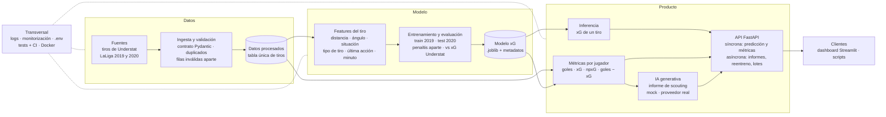

# Arquitectura del pipeline xG

Proyecto de máster · Desarrollo de Soluciones de IA (Python)
Dominio: fútbol · Modelo de expected goals (xG) + informes de scouting con IA generativa

## Índice

1. [Alcance](#1-alcance)
2. [Diagrama general](#2-diagrama-general)
3. [Etapas del pipeline](#3-etapas-del-pipeline)
4. [Decisiones de diseño](#4-decisiones-de-diseño)
5. [Supuestos y limitaciones](#5-supuestos-y-limitaciones)
6. [Estructura del repositorio](#6-estructura-del-repositorio)

---

## 1. Alcance

- **Datos:** tiros de Understat, LaLiga, temporadas `2019` (2019-20) y `2020` (2020-21), en CSV con las columnas `shot_id, match_id, date, season, league, h_team, a_team, h_a, player, player_id, minute, x, y, situation, shot_type, last_action, preferred_foot, is_goal, xg_understat`.
- **Modelo:** clasificador de scikit-learn que estima `P(is_goal = 1)` para tiros que no son penalti. Los penaltis reciben un valor fijo.
- **IA generativa:** cliente con modo `mock` y proveedor real que redacta informes de scouting a partir de las métricas de un jugador.
- **Exposición:** API FastAPI (endpoints síncronos y asíncronos) y dashboard Streamlit que consume la API, ambos en Docker, con logs y monitorización.
- **Fuera de alcance:** colas distribuidas (Kafka, Celery), orquestadores (Kubernetes, Airflow), feature stores.

---

## 2. Diagrama general

Vista conceptual del sistema. El detalle de cada bloque (módulos, entradas, salidas y tipos de dato) está en la sección 3.



---

## 3. Etapas del pipeline

### 3.1 Fuentes de datos

| Módulo | Entrada | Salida | Tipo de dato | Tecnología | Modo |
|---|---|---|---|---|---|
| — (fichero manual) | Descarga Understat | `data/raw/understat_laliga_2019.csv`, `data/raw/understat_laliga_2020.csv` | CSV | — | batch |
| — (fichero manual) | Nuevas temporadas | `data/raw/*.csv` | CSV | — | batch |
| `sources.py` (futuro) | URL + API key | `data/raw/api_<fecha>.json` | JSON | httpx | batch |

### 3.2 Ingesta

| Módulo | Entrada | Salida | Tipo de dato | Tecnología | Modo |
|---|---|---|---|---|---|
| `loader.py` | Ruta de fichero | DataFrame crudo con columnas normalizadas + columna `source` | CSV/JSON → DataFrame | pandas | batch |
| `validator.py` | DataFrame crudo | (válidas, inválidas con columna `error`) | `ShotRecord` (Pydantic) → DataFrame | Pydantic v2 | batch |
| `ingesta.py` | Lista de rutas + config | `shots.parquet`, `rejected/*.csv`, resumen en el log | Parquet / CSV | pandas, pyarrow | batch (CLI) |

**Datos inválidos:**
- Se guardan en `data/rejected/<source>_<timestamp>.csv` con el motivo del error de Pydantic.
- Se registra cuántas filas se han rechazado.
- Si superan un umbral configurable (p. ej. 5 %), la ingesta termina con error.

**Duplicados:**
- Se eliminan por `shot_id` dentro de cada fuente.
- Si en el futuro se combinan fuentes con IDs distintos, se usará una clave natural (`match_id`, `minute`, `player_id`, `x`, `y`).

**Penaltis:** se mantienen en `shots.parquet`. Solo se separan en la etapa de entrenamiento.

### 3.3 Análisis y feature engineering

| Módulo | Entrada | Salida | Tipo de dato | Tecnología | Modo |
|---|---|---|---|---|---|
| `features.py::add_geometry` | DataFrame con `x`, `y` | DataFrame + `distance`, `angle` | DataFrame → DataFrame | numpy, pandas | batch y síncrono (misma función) |
| `features.py::build_preprocessor` | — | `ColumnTransformer` (one-hot + passthrough numéricas) | objeto sklearn | scikit-learn | — |
| `notebooks/01_eda.ipynb` | `shots.parquet` | Gráficas y decisiones documentadas | — | pandas, matplotlib | manual |

**Conversión de coordenadas.** En Understat, `x = 1` es la línea de gol rival e `y = 0.5` es el centro. Se asume un campo de 105 × 68 m:

$$x_m = (1 - x)\cdot 105, \qquad y_m = (y - 0.5)\cdot 68$$

$$X_1 = d = \sqrt{x_m^2 + y_m^2}$$

$$X_2 = \theta = \operatorname{atan2}\!\left(7.32\,x_m,\; x_m^2 + y_m^2 - 3.66^2\right)$$

donde θ es el ángulo (en radianes) con el que se ven los dos postes desde el punto de tiro.

**Vector de entrada (solo describe el tiro):**

| Variable | Origen | Tratamiento |
|---|---|---|
| X1 `distance` | `x`, `y` | numérica (m) |
| X2 `angle` | `x`, `y` | numérica (rad) |
| X3 `situation` | `situation` | one-hot: OpenPlay, FromCorner, SetPiece, DirectFreekick (Penalty se excluye, ver 4.2) |
| X4 `shot_type` | `shot_type` | one-hot: RightFoot, LeftFoot, Head, OtherBodyPart |
| X5 `last_action` | `last_action` | one-hot con `min_frequency` (las categorías raras se agrupan) y `handle_unknown="infrequent_if_exist"` |
| X6 `minute` | `minute` | numérica |

**Objetivo:** `y = is_goal ∈ {0, 1}`.

**Excluidas del modelo:**

| Columnas | Motivo |
|---|---|
| `xg_understat` | Solo se usa como benchmark en la evaluación; como feature sería fuga de información. |
| `player`, `player_id`, `match_id`, `h_team`, `a_team`, `h_a`, `date`, `season`, `league` | No describen el tiro. Si entraran, el modelo dejaría de ser agnóstico al jugador, que es justo lo que se quiere evaluar. |
| `preferred_foot` | Es un atributo del jugador, no del tiro. Se conserva en los datos para las métricas de scouting. |

### 3.4 Trainer

| Módulo | Entrada | Salida | Tipo de dato | Tecnología | Modo |
|---|---|---|---|---|---|
| `ml/split.py` | `shots.parquet` | (train = todas las temporadas menos la última, test = la última); hoy, 2019 / 2020 | DataFrame | pandas | batch |
| `ml/penalties.py` | Train | `penalty_xg` = tasa de conversión de penaltis en train; train sin penaltis | float + DataFrame | pandas | batch |
| `ml/train.py` | Train sin penaltis, hiperparámetros | Pipeline entrenado (`add_geometry` → preprocesador → modelo) | DataFrame → `sklearn.Pipeline` | scikit-learn | batch (CLI o job async) |
| `ml/evaluate.py` | Pipeline + test sin penaltis | Métricas del modelo y de `xg_understat` sobre las mismas filas; curva de calibración | dict → JSON, PNG | sklearn.metrics, matplotlib | batch |
| `ml/registry.py` | Pipeline + métricas + `penalty_xg` | `xg_model_vN.joblib`, `xg_model_vN.json`, `models/current.json` | .joblib, JSON | joblib | batch |
| `metrics.py` | `shots.parquet` + modelo + `penalty_xg` | `player_metrics.parquet` (por jugador y temporada) | Parquet | pandas | batch |

**Protocolo de entrenamiento:**

1. Split temporal: train = 2019, test = 2020. Ningún partido aparece en ambos conjuntos.
2. Se separan los penaltis de train y se calcula `penalty_xg` (tasa de conversión).
3. **Selección de modelo e hiperparámetros solo dentro de train**, con `GroupKFold` por `match_id`. Candidatos: `LogisticRegression` (baseline) y `HistGradientBoostingClassifier`.
4. Ajuste final de la configuración elegida sobre todo el train sin penaltis.
5. Evaluación única sobre el test 2020 sin penaltis:
   - Métrica principal: log loss.
   - Secundarias: Brier, ROC-AUC y curva de calibración.
   - Las mismas métricas se calculan usando `xg_understat` como predicción, como benchmark.
6. Guardado del Pipeline completo y de los metadatos.

**Contenido de `xg_model_vN.json`:** versión, fecha, lista de features, temporadas de train/test, métricas (modelo y benchmark), `penalty_xg`, nº de penaltis usados para estimarlo, versiones de Python y scikit-learn, hash de `shots.parquet`.

### 3.5 Serving / inferencia

| Módulo | Entrada | Salida | Tipo de dato | Tecnología | Modo |
|---|---|---|---|---|---|
| `ml/predictor.py::Predictor.load` | `models/current.json` | `Predictor` (Pipeline + `penalty_xg` + versión) en `app.state` | .joblib + JSON → objeto | joblib | una vez al arrancar (lifespan) |
| `ml/predictor.py::predict_one` | `ShotIn` | `PredictionOut` | Pydantic → DataFrame 1 fila → float | scikit-learn | síncrono |
| `ml/predictor.py::predict_batch` | `list[ShotIn]` / DataFrame | `list[PredictionOut]` | DataFrame → ndarray | scikit-learn | asíncrono (job) |

**Flujo de una predicción:**

1. Se valida `ShotIn` con Pydantic. Las categorías desconocidas se rechazan con 422.
2. Si `situation == "Penalty"` → `xg = penalty_xg`, `source = "penalty_rule"`.
3. Si no → DataFrame de una fila → `Pipeline.predict_proba(...)[:, 1]`, `source = "model"`.
4. Post-procesado: redondeo a 4 decimales, se añaden `model_version` y `source`, y se registra en `predictions_log`.

### 3.6 IA generativa

| Módulo | Entrada | Salida | Tipo de dato | Tecnología | Modo |
|---|---|---|---|---|---|
| `genai/base.py` | — | `ReportClient` (Protocol): `generate(metrics: PlayerMetrics) -> Report` | interfaz | typing | — |
| `genai/mock_client.py` | `PlayerMetrics` | `Report` determinista con plantilla | Pydantic → str | — | síncrono (tests/CI) |
| `genai/real_client.py` | `PlayerMetrics` + prompt | `Report` (texto, proveedor, modelo, fecha) | JSON → str | SDK del proveedor / httpx, con timeout y reintentos | asíncrono (job) |
| `genai/prompts.py` | `PlayerMetrics` | Prompt que obliga a usar solo las cifras recibidas, a distinguir xG de npxG y a mencionar la falta de minutos jugados | str | — | — |

El proveedor se elige con `GENAI_PROVIDER=mock|real` en `.env`.

### 3.7 API (FastAPI)

| Endpoint | Entrada | Salida | Modo |
|---|---|---|---|
| `GET /health` | — | `{"status": "ok", "model_loaded": true, "model_version": "v1"}` | síncrono |
| `POST /predict` | `ShotIn` → `{"x", "y", "situation", "shot_type", "last_action", "minute"}` | `{"xg": 0.0871, "model_version": "v1", "source": "model"}` o `{"xg": 0.76, ..., "source": "penalty_rule"}` | síncrono |
| `GET /players/{id}/metrics` | path `id: int`, query `season` opcional | `PlayerMetrics` (ver abajo); 404 si no existe | síncrono |
| `GET /monitoring/stats` | query `since` opcional | `{n_predictions, n_by_source, latency_p50_ms, latency_p95_ms, xg_mean_non_penalty, xg_histogram_non_penalty}` | síncrono |
| `POST /reports` | `{"player_id": 123, "season": 2020}` | `202 {"job_id": "...", "status": "pending"}` | asíncrono |
| `POST /train` | `{"model_type": "logreg"}` | `202 {"job_id": "...", "status": "pending"}` | asíncrono |
| `POST /predict/batch` | `{"shots": [ShotIn, ...]}` | `202 {"job_id": "...", "status": "pending"}` | asíncrono |
| `GET /jobs/{job_id}` | path `job_id: str` | `{job_id, type, status, result, error, created_at, finished_at}`; `status ∈ {pending, running, done, failed}` | síncrono (consulta) |

**`PlayerMetrics`** (por jugador y temporada):
- Identificación: `player_id`, `player`, `season`.
- Volumen: `shots`, `np_shots`, `goals`, `np_goals`.
- xG: `xg`, `npxg`, `xg_understat`.
- Diferencias: `goals_minus_xg`, `np_goals_minus_npxg`.
- Ratio: `npxg_per_shot`.
- Desglose: `by_shot_type`.
- Control: `in_sample: bool` (true si la temporada se usó para entrenar el modelo).

**Mecanismo asíncrono:**

1. El `POST` inserta una fila en la tabla `jobs` (SQLite) con `job_id = uuid4()` y `status = "pending"`, y devuelve `202`.
2. `background_tasks.add_task(run_job, job_id, ...)`.
3. `run_job` (definido con `def`, no `async def`, para que Starlette lo ejecute en el threadpool) pasa a `running`, ejecuta la tarea y guarda `result` en JSON o `error`.
4. El cliente consulta `GET /jobs/{job_id}` cada ~2 s.
5. Al arrancar la API, los jobs que hayan quedado en `running` se marcan como `failed`.

### 3.8 Clientes

| Módulo | Entrada | Salida | Tipo de dato | Tecnología | Modo |
|---|---|---|---|---|---|
| `dashboard/app.py` | Acciones del usuario | Llamadas HTTP → JSON → DataFrame → gráficas | JSON | Streamlit, requests | síncrono + polling para jobs |
| `dashboard/pages/1_prediccion.py` | Tiro introducido en el campo | xG del tiro | JSON | Streamlit | síncrono |
| `dashboard/pages/2_jugadores.py` | Jugador + temporada | Métricas + informe generado | JSON | Streamlit | síncrono + job |
| `dashboard/pages/3_monitorizacion.py` | `/monitoring/stats` | Histograma de xG, latencias, nº de predicciones | JSON | Streamlit | síncrono |
| Notebooks / scripts | — | Llamadas a la API | JSON | requests | síncrono |
| `cli.py` | Comandos `ingest`, `train`, `evaluate` | Ingesta y entrenamiento local | ficheros | Typer / argparse | batch |

El dashboard solo conoce `API_URL`. Nunca lee `data/` ni `models/` directamente.

### 3.9 Transversal

| Módulo | Qué hace | Tecnología |
|---|---|---|
| `config.py` | Lee `.env`: `DATA_DIR`, `MODEL_DIR`, `DB_PATH`, `GENAI_PROVIDER`, `GENAI_API_KEY`, `API_URL`, `LOG_LEVEL`, `REJECT_THRESHOLD` | pydantic-settings |
| `logging_config.py` | Logs en JSON a stdout y `logs/app.log` | logging (stdlib) |
| `api/monitoring.py` | Middleware de latencia por request; escritura en `predictions_log`; aviso si la media de xG (sin penaltis) se aleja de la del entrenamiento | FastAPI middleware, SQLite |
| `tests/` | Unit (features, validator, split, penalties, predictor con las dos rutas) + integración (API con `TestClient` y `MockClient`) | pytest, httpx |
| `.github/workflows/ci.yml` | lint → tests → build de la imagen Docker | GitHub Actions, ruff |
| `Dockerfile.api`, `Dockerfile.dashboard`, `docker-compose.yml` | Dos servicios: `api` y `dashboard` | Docker |

---

## 4. Decisiones de diseño

### 4.1 Features que solo describen el tiro

El modelo usa distancia, ángulo, situación, tipo de tiro, última acción y minuto. Quedan fuera los identificadores (jugador, partido, equipos) y `xg_understat`.

Así el xG mide la calidad de la ocasión con independencia de quién tira. Es la condición necesaria para luego comparar goles − xG entre jugadores. `xg_understat` solo aparece en la evaluación, como benchmark sobre las mismas filas del test.

### 4.2 Penaltis fuera del entrenamiento, con valor fijo

Los penaltis se excluyen del entrenamiento y del test del modelo. En inferencia reciben `penalty_xg`, que es la tasa de conversión de penaltis en train y se guarda en los metadatos del modelo.

Motivos:
- Es un mecanismo distinto (posición fija, sin defensa), con una probabilidad prácticamente constante que se estima mejor como tasa empírica que aprendida por el modelo.
- Permite reportar npxG, que es la métrica estándar para valorar a un jugador sin que lanzar penaltis la infle.
- Deja una evaluación limpia, sin tiros triviales que mejoren las métricas artificialmente.

Coste: dos rutas en `predictor.py`, cubiertas por tests.

### 4.3 Split temporal + selección de modelo dentro de train

- Train = 2019, test = 2020. Es un escenario realista (predecir una temporada futura) y garantiza que ningún partido está en los dos conjuntos.
- La elección de modelo e hiperparámetros se hace con `GroupKFold` por `match_id` dentro de 2019. El test 2020 se usa una sola vez; si se usara para decidir, dejaría de ser una estimación honesta.
- La regla se generaliza a "train = todas las temporadas menos la última, test = la última", para que `/train` funcione sin cambios cuando se añadan temporadas.

### 4.4 Separar entrenamiento y serving

Entrenar es batch, lento y poco frecuente. Predecir tiene que ser rápido y estar siempre disponible. Separarlos permite reentrenar sin tocar la API, y la API no carga datos de entrenamiento ni dependencias de evaluación.

### 4.5 Guardar el Pipeline completo

El `.joblib` contiene `add_geometry` (como `FunctionTransformer`), el preprocesador y el modelo. Serving no puede calcular las features de forma distinta a train.

joblib guarda la función por referencia de import, así que basta con tener el paquete `football_shots` instalado en la imagen de la API.

### 4.6 `.joblib` frente a `.pickle` y `.onnx`

| Formato | Ventajas | Inconvenientes |
|---|---|---|
| `.joblib` | Estándar de scikit-learn; eficiente con arrays de numpy | Solo Python; dependiente de la versión de sklearn; inseguro con ficheros no confiables |
| `.pickle` | Sin dependencias extra | Mismos riesgos que joblib y menos eficiente con arrays grandes |
| `.onnx` | Portable, inferencia rápida, sin Python | Conversión con `skl2onnx` complicada con transformers propios; innecesario si se sirve desde Python |

**Elegido: `.joblib`.** Se fija la versión de scikit-learn en el `.json` de metadatos y en `pyproject.toml`, y solo se cargan modelos generados por el propio pipeline.

### 4.7 IA generativa asíncrona

Una llamada a un LLM tarda segundos, puede fallar o dar timeout y tiene coste. Ejecutarla dentro de una request bloquearía la API y el dashboard. Un job con estado permite reintentos, mostrar progreso y guardar el resultado.

### 4.8 BackgroundTasks + SQLite en vez de Celery/Redis

Basta para un único servidor y un volumen bajo, no añade servicios y es fácil de testear. El estado de los jobs se guarda en SQLite y no en memoria, porque un dict en memoria fallaría con varios workers de uvicorn.

Las tareas que usan CPU (entrenar) se definen con `def` para que corran en el threadpool y no bloqueen el event loop.

### 4.9 Parquet para datos, SQLite para estado

- **Parquet:** conserva tipos y se lee rápido con pandas; adecuado para tiros y métricas agregadas.
- **SQLite:** para lo que se escribe fila a fila (jobs, log de predicciones).
- `player_metrics.parquet` es pequeño y se carga en memoria al arrancar la API.

### 4.10 El dashboard consume la API

Hay un único punto de verdad. Si cambian el modelo o el almacenamiento, el dashboard no se ve afectado, y se demuestra que la API sirve a cualquier cliente.

### 4.11 Mock por defecto en tests y CI

Tests deterministas, sin coste y sin secretos en GitHub Actions. El cliente real solo se usa con `GENAI_PROVIDER=real`.

### 4.12 Regresión logística como baseline

Suele salir bien calibrada y es interpretable (coeficientes de distancia y ángulo), que es lo que importa en xG. HistGradientBoosting se compara en validación cruzada y solo se elige si mejora el log loss sin empeorar la calibración.

### 4.13 Validación Pydantic en dos puntos con tipos compartidos

`ShotRecord` (ingesta) y `ShotIn` (API) reutilizan los mismos `Literal`/`Enum` de `schemas.py`. Una categoría desconocida se rechaza antes de llegar al modelo.

### 4.14 Promoción de modelo explícita

`/train` genera un candidato `vN+1`. `models/current.json` solo se actualiza si su log loss en el test mejora al del modelo actual. Después la API recarga `app.state.predictor`; reasignar la referencia es atómico y no rompe requests en curso.

---

## 5. Supuestos y limitaciones

1. **Sin minutos jugados.** Los datos no incluyen minutos por jugador, así que no hay métricas por 90'. Las métricas son totales y ratios por tiro (npxG/tiro, goles − xG, goles sin penalti − npxG).
2. **Métricas in-sample en 2019.** El modelo se entrena con los tiros de 2019, así que el xG de los jugadores en esa temporada es in-sample. Las métricas de 2020 son out-of-sample. `PlayerMetrics.in_sample` lo indica y el prompt del informe lo tiene en cuenta.
3. **Dimensiones del campo.** La conversión a metros asume 105 × 68 m. Los campos reales varían ligeramente.
4. **Estimación de `penalty_xg`.** Se basa en los penaltis de una sola temporada, con un error estándar de unos pocos puntos porcentuales. Se documenta el nº de penaltis usado en los metadatos.
5. **Cambio de distribución entre temporadas.** La temporada 2020-21 se jugó en gran parte sin público. El efecto local queda fuera de las features, pero el test 2020 puede diferir de 2019 por otros motivos de contexto.
6. **Información no disponible.** Understat no da la posición de defensores ni del portero, la altura del balón ni la velocidad del pase. El techo del modelo está limitado por esto.
7. **Jobs en proceso.** Los jobs asíncronos viven en el proceso de la API; un reinicio los interrumpe y quedan marcados como `failed`.

---

## 6. Estructura del repositorio

```
football-xg/
├── .github/workflows/ci.yml
├── data/
│   ├── raw/                       # CSV/JSON originales, inmutables
│   ├── processed/                 # shots.parquet, player_metrics.parquet
│   └── rejected/                  # filas inválidas + motivo
├── docs/
│   └── ARQUITECTURA.md
├── models/
│   ├── xg_model_v1.joblib
│   ├── xg_model_v1.json           # features, métricas, penalty_xg, versiones, hash de datos
│   └── current.json               # puntero al modelo en producción
├── notebooks/
│   └── 01_eda.ipynb
├── src/football_shots/
│   ├── __init__.py
│   ├── config.py                  # pydantic-settings
│   ├── logging_config.py
│   ├── schemas.py                 # Enums/Literals compartidos, ShotRecord, PlayerMetrics
│   ├── loader.py                  # ya existe
│   ├── validator.py               # ya existe
│   ├── ingesta.py
│   ├── features.py                # add_geometry, build_preprocessor
│   ├── metrics.py                 # ya existe (agregados por jugador y temporada)
│   ├── cli.py                     # ya existe (+ ingest / train / evaluate)
│   ├── ml/
│   │   ├── split.py               # split temporal
│   │   ├── penalties.py           # separación y penalty_xg
│   │   ├── train.py
│   │   ├── evaluate.py
│   │   ├── registry.py            # guardar / cargar / promocionar modelos
│   │   └── predictor.py           # ruta modelo + ruta penalti
│   ├── genai/
│   │   ├── base.py
│   │   ├── mock_client.py
│   │   ├── real_client.py
│   │   └── prompts.py
│   └── api/
│       ├── main.py                # app, lifespan (carga del modelo), middleware
│       ├── schemas.py             # ShotIn, PredictionOut, JobStatus...
│       ├── jobs.py                # tabla SQLite + run_job
│       ├── monitoring.py
│       └── routers/
│           ├── health.py
│           ├── predict.py
│           ├── players.py
│           ├── reports.py
│           ├── train.py
│           ├── jobs.py
│           └── monitoring.py
├── dashboard/
│   ├── app.py
│   └── pages/
│       ├── 1_prediccion.py
│       ├── 2_jugadores.py
│       └── 3_monitorizacion.py
├── tests/
│   ├── unit/                      # features, validator, split, penalties, predictor, genai_mock
│   ├── integration/               # API con TestClient + MockClient
│   └── fixtures/                  # CSV mini (~50 tiros, ambas temporadas, con penaltis)
├── logs/                          # en .gitignore
├── .env.example                   # se sube; .env no
├── Dockerfile.api
├── Dockerfile.dashboard
├── docker-compose.yml
├── pyproject.toml
└── README.md
```

`loader.py`, `validator.py`, `metrics.py` y `cli.py` se mantienen en la raíz del paquete para no romper los imports ni los tests existentes. Los bloques nuevos van en subpaquetes.