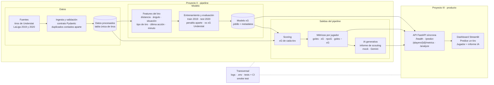

# Arquitectura del proyecto xG

Proyecto de máster · Desarrollo de Soluciones de IA (Python)
Modelo de expected goals (xG) con datos de Understat + informes de scouting con IA generativa.

| Entrega | Fecha | Tag |
|---|---|---|
| Proyecto II (pipeline) | 12 nov | `v0.2.0` |
| Proyecto III · Release Candidate | 23 nov | `v1.0.0-rc` |
| Proyecto III · exposición (5-7 min) | 30 nov | `v1.0.0` |

## Índice

1. [Alcance](#1-alcance)
2. [Diagrama general](#2-diagrama-general)
3. [Etapas](#3-etapas)
4. [Decisiones de diseño](#4-decisiones-de-diseño)
5. [Limitaciones](#5-limitaciones)
6. [Estructura del repositorio](#6-estructura-del-repositorio)
7. [Plan de entregas](#7-plan-de-entregas)
8. [Trabajo futuro](#8-trabajo-futuro)

---

## 1. Alcance

- **Datos:** CSV de tiros de Understat (`data/raw/shots_laliga.csv`), LaLiga, temporadas `2019` (2019-20) y `2020` (2020-21). Son 20.832 filas, de las que 4.704 son duplicados (22,6 %).
- **Proyecto II:** ingesta, features, entrenamiento, evaluación, scoring por CLI, métricas por jugador y cliente de IA generativa (mock por defecto, Gemini como proveedor real), con logs y tests.
- **Proyecto III:** API FastAPI síncrona (`/health`, `/predict`, `/players/{id}/metrics`, `/analyze`) y dashboard Streamlit que consume la API, con despliegue documentado y smoke test.
- **Extras ⭐ (solo si sobra tiempo):** `/analyze` asíncrono, docker-compose y despliegue en Render.

---

## 2. Diagrama general

Vista conceptual. El detalle de cada bloque está en la sección 3.



---

## 3. Etapas

Todo el sistema es síncrono. Las etapas del Proyecto II se ejecutan en batch desde la CLI (`ingest`, `train`, `score`). Las del Proyecto III responden a peticiones HTTP. Los logs usan `logging` de la stdlib, configurado en `config.py`.

### 3.1 Ingesta · Proyecto II

| Fichero | Entrada | Salida | Tecnología |
|---|---|---|---|
| `loader.py` (ya existe) | `data/raw/shots_laliga.csv` | DataFrame crudo | pandas |
| `validator.py` (ya existe) | DataFrame crudo | Filas válidas e inválidas (con motivo) | Pydantic v2 (`ShotRecord` y sus `Literal`) |
| `ingesta.py` | Ruta del CSV | `data/processed/shots.csv`, `data/rejected/invalid_rows.csv` | pandas |

- **Inválidos:** se guardan con el motivo del error de Pydantic. No hay umbral de rechazo.
- **Duplicados:** se eliminan por `shot_id` y se cuentan aparte (4.704 de 20.832). No se tratan como errores.
- **Penaltis:** se quedan en `shots.csv`. Se separan en el entrenamiento.
- **Logs:** filas cargadas, duplicados eliminados, filas rechazadas y filas finales.

### 3.2 Features · Proyecto II

| Fichero | Entrada | Salida | Tecnología |
|---|---|---|---|
| `features.py` | DataFrame con `x`, `y`, categóricas | `add_geometry` (distancia y ángulo) y `build_preprocessor` (`ColumnTransformer`) | numpy, scikit-learn |

Conversión de coordenadas (Understat: `x = 1` es la línea de gol rival, `y = 0.5` es el centro; campo de 105 × 68 m):

$$x_m = (1 - x)\cdot 105, \qquad y_m = (y - 0.5)\cdot 68$$

$$X_1 = d = \sqrt{x_m^2 + y_m^2}, \qquad X_2 = \theta = \operatorname{atan2}\!\left(7.32\,x_m,\; x_m^2 + y_m^2 - 3.66^2\right)$$

| Variable | Tratamiento |
|---|---|
| X1 `distance` | numérica (m) |
| X2 `angle` | numérica (rad) |
| X3 `situation` | one-hot: OpenPlay, FromCorner, SetPiece, DirectFreekick |
| X4 `shot_type` | one-hot: RightFoot, LeftFoot, Head, OtherBodyPart |
| X5 `last_action` | vacíos (2.436) → `"None"`; después one-hot con `min_frequency` |
| X6 `minute` | numérica |

Objetivo: `y = is_goal ∈ {0, 1}`.

Fuera del modelo:
- `xg_understat` (solo benchmark).
- Identificadores, equipos, `h_a`, fecha, temporada y `preferred_foot`, porque no describen el tiro.

### 3.3 Entrenamiento y evaluación · Proyecto II

| Fichero | Entrada | Salida | Tecnología |
|---|---|---|---|
| `train.py` | `shots.csv` | `models/xg_model.joblib` (Pipeline completo) + `models/xg_model.json` | scikit-learn, joblib |
| `evaluate.py` | Pipeline + test | Métricas en `xg_model.json`, `reports/calibration.png` | sklearn.metrics, matplotlib |

`train.py` expone dos funciones:
- `select_model(df)`: validación cruzada para elegir el modelo.
- `fit_pipeline(df, config)`: ajuste directo, sin validación cruzada. Es la que usan la fixture de tests y el paso 4.

Protocolo:
1. Split temporal: train = 2019, test = 2020.
2. Se separan los penaltis de train. `penalty_xg` = tasa de conversión de penaltis en train.
3. `select_model` con `GroupKFold` por `match_id` dentro de 2019. Se comparan `LogisticRegression` (baseline) y `HistGradientBoostingClassifier`.
4. `fit_pipeline` con la configuración elegida, sobre todo 2019 sin penaltis.
5. Evaluación única sobre 2020 sin penaltis: log loss (principal), Brier, ROC-AUC y curva de calibración. Las mismas métricas se calculan para `xg_understat` sobre las mismas filas.

`xg_model.json` contiene: features, temporadas de train/test, métricas del modelo y del benchmark, `penalty_xg`, nº de penaltis usados, versión de scikit-learn y fecha.

**Logs:** tamaño de train y test, nº de penaltis y `penalty_xg`, resultado de la validación cruzada por candidato, modelo elegido y métricas finales frente a `xg_understat`.

### 3.4 Scoring y métricas por jugador · Proyecto II

| Fichero | Entrada | Salida | Tecnología |
|---|---|---|---|
| `predictor.py` | Modelo + tiro(s) | xG; ruta penalti (`penalty_xg`) o ruta modelo (`predict_proba`) | scikit-learn, joblib |
| `cli.py` (ya existe) · comando `score` | `shots.csv` + modelo | `data/processed/shots_scored.csv` (columna `xg_model`) | pandas |
| `metrics.py` (ya existe) | `shots_scored.csv` | `data/processed/player_metrics.csv` | pandas |

`PlayerMetrics`, por jugador y temporada:
- Identificación: `player_id`, `player`, `season`.
- Volumen: `shots`, `np_shots`, `goals`, `np_goals`.
- xG: `xg`, `npxg`, `xg_understat`.
- Diferencias y ratio: `goals_minus_xg`, `np_goals_minus_npxg`, `npxg_per_shot`.
- Control: `in_sample` (true en 2019).

**Logs:** tiros puntuados, cuántos van por la ruta modelo y cuántos por la ruta penalti, y nº de jugadores con métricas.

### 3.5 IA generativa · Proyecto II

| Fichero | Entrada | Salida | Tecnología |
|---|---|---|---|
| `genai.py` | `PlayerMetrics` | Informe de scouting (texto) | `MockClient` (plantilla determinista) · `GeminiClient` (google-genai, timeout configurable) |

- El proveedor se elige con `GENAI_PROVIDER=mock|gemini`. Por defecto es `mock`.
- El prompt obliga a usar solo las cifras recibidas, a distinguir xG de npxG y a avisar de que no hay minutos jugados ni de cuándo `in_sample` es true.

### 3.6 API FastAPI · Proyecto III

| Fichero | Contenido | Tecnología |
|---|---|---|
| `api/main.py` | App, carga del modelo y de `player_metrics.csv` al arrancar, middleware de logs, handlers de error, endpoints | FastAPI, uvicorn |
| `api/schemas.py` | `ShotIn`, `PredictionOut`, `AnalyzeIn`, `AnalyzeOut`, `HealthOut` (los `Literal` se importan de `validator.py`) | Pydantic v2 |

| Endpoint | Entrada | Salida |
|---|---|---|
| `GET /health` | — | `{"status": "ok" \| "degraded", "model_loaded": true, "genai_provider": "mock", "genai_configured": true}` |
| `POST /predict` | `{"x", "y", "situation", "shot_type", "last_action", "minute"}` (`last_action` opcional, por defecto `"None"`) | `{"xg": 0.0871, "source": "model"}` o `{"xg": 0.76, "source": "penalty_rule"}` |
| `GET /players/{id}/metrics` | path `id`, query `season` (por defecto 2020) | `PlayerMetrics` |
| `POST /analyze` | `{"player_id": 123, "season": 2020}` | `{"report": "..."}` |

`degraded` significa que no hay modelo cargado, o que `GENAI_PROVIDER=gemini` está configurado sin API key. `/health` no llama a Gemini.

**Errores:**

| Código | Cuándo |
|---|---|
| 400 | Entrada inválida. FastAPI devuelve 422 por defecto, así que se registra un handler de `RequestValidationError` que responde 400. |
| 404 | Jugador o temporada inexistente. |
| 502 | El proveedor de IA devuelve un error. |
| 504 | El proveedor de IA supera el timeout. |
| 500 | Error inesperado. Mensaje genérico, sin traza, con `request_id`. |

**Logs:** un middleware genera un `request_id` por petición y escribe una línea con `request_id`, método, ruta, estado y `latency_ms`.

### 3.7 Dashboard · Proyecto III

| Fichero | Contenido | Tecnología |
|---|---|---|
| `dashboard/app.py` | Página "Predice un tiro" + estado de la API (`/health`) en la barra lateral | Streamlit, requests |
| `dashboard/pages/2_jugador.py` | Página "Jugador + informe IA" (`/players/{id}/metrics` y `/analyze`) | Streamlit, requests |
| `dashboard/api_client.py` | Llamadas a la API y gestión de errores | requests |

El dashboard solo conoce `API_URL`. Nunca lee `data/` ni `models/`.

### 3.8 Transversal

| Fichero | Contenido | Entrega |
|---|---|---|
| `config.py` | Lee `.env` con python-dotenv (`MODEL_PATH`, `DATA_DIR`, `GENAI_PROVIDER`, `GEMINI_API_KEY`, `GEMINI_MODEL`, `GENAI_TIMEOUT_S`, `API_URL`, `LOG_LEVEL`) y configura `logging` | II |
| `.env.example` | Plantilla de variables (`.env` va en `.gitignore`) | II |
| `tests/conftest.py` | Fixture que entrena un modelo mini con `fit_pipeline` sobre `tests/fixtures/shots_mini.csv` y lo guarda en un directorio temporal | II |
| `tests/fixtures/shots_mini.csv` | ~50 tiros de las dos temporadas, con penaltis (alguno en 2019) y al menos 5 goles | II |
| `tests/` | `test_features.py`, `test_predictor.py` (ruta modelo y ruta penalti), `test_genai.py` (mock), `test_api.py` (TestClient + mock) | II y III |
| `.github/workflows/ci.yml` (ya existe) | pytest con `GENAI_PROVIDER=mock` | II |
| `requirements.txt` | Dependencias exportadas (ver abajo) | II y III |
| `scripts/smoke_test.sh` | Comprueba que `/health` responde 200 y que `/predict` devuelve un `xg` entre 0 y 1 | III |
| `AI_USAGE.md` | Uso de IA en el desarrollo | II |
| `README.md` | Uso de la CLI, métricas del modelo, curva de calibración y sección de despliegue | II y III |

**Dependencias** (se añaden a las que ya usa el paquete, como pandas y Pydantic):

| Proyecto | Dependencias nuevas |
|---|---|
| II | `scikit-learn`, `matplotlib`, `python-dotenv`, `google-genai` |
| III | `fastapi`, `uvicorn`, `httpx`, `streamlit`, `requests` |

`requirements.txt` se genera en cada entrega con:

```bash
uv export --format requirements-txt --no-hashes -o requirements.txt
```

Por defecto `uv export` incluye el grupo dev (pytest). Si solo se quieren las dependencias de producción, se añade `--no-dev`.

**README del Proyecto II (`v0.2.0`):**
- Uso de la CLI: `ingest`, `train`, `score`.
- Tabla de métricas del modelo frente a `xg_understat` en el test 2020 sin penaltis: log loss, Brier y ROC-AUC.
- Curva de calibración (`reports/calibration.png`).

**Despliegue (sección del README, Proyecto III):**
1. **Build:** `pip install -r requirements.txt` y `pip install -e .`
2. **Variables de entorno:** copiar `.env.example` a `.env` y rellenarlo.
3. **Arranque:**
   - API: `uvicorn football_shots.api.main:app --host 0.0.0.0 --port 8000`
   - Dashboard: `streamlit run dashboard/app.py`
4. **Smoke:** `scripts/smoke_test.sh http://localhost:8000`
5. **Rollback:** `git checkout <tag anterior>`, reinstalar y volver a arrancar.

---

## 4. Decisiones de diseño

1. **Features que solo describen el tiro.** El xG mide la calidad de la ocasión sin importar quién tira. Es la condición para comparar goles − xG entre jugadores.
2. **`xg_understat` solo como benchmark.** Como feature sería fuga de información. Se compara sobre las mismas filas del test.
3. **Penaltis aparte con valor fijo y npxG.** Un penalti tiene una probabilidad casi constante, que se estima mejor como tasa empírica. Separarlos permite reportar npxG (la métrica estándar para valorar a un jugador) y deja una evaluación limpia. Coste: dos rutas en `predictor.py`, ambas con test.
4. **Split temporal 2019/2020 + `GroupKFold` dentro de 2019.** Es un escenario realista (predecir la temporada siguiente) y ningún partido aparece en train y test. El test se usa una sola vez; la elección de modelo se hace solo con 2019.
5. **Pipeline completo en `.joblib`.** Geometría, preprocesado y modelo van juntos, así que la API no puede calcular las features de otra forma. Se elige `.joblib` frente a `.pickle` (mismo mecanismo, menos eficiente) y `.onnx` (conversión complicada e innecesaria sirviendo desde Python). Se fija la versión de scikit-learn y solo se cargan modelos propios.
6. **Artefactos del modelo en el repo; tests independientes de ellos.** `xg_model.joblib` y `xg_model.json` son pequeños y se suben, así la API arranca sin entrenar. Los tests usan un modelo mini entrenado en `conftest.py`, de modo que no se rompen al reentrenar ni dependen de un fichero binario.
7. **Separar selección de modelo y ajuste.** `select_model` (validación cruzada) solo tiene sentido con datos reales. `fit_pipeline` (ajuste directo) sirve también para la fixture de ~50 tiros, donde los pliegues se quedarían sin goles.
8. **Separar entrenamiento y serving.** Se entrena una vez con la CLI. La API solo carga el modelo al arrancar.
9. **Un único modelo, sin versionado.** Para reentrenar: `train`, subir el nuevo artefacto y reiniciar la API.
10. **CSV en vez de Parquet o SQLite.** Con unos 16.000 tiros no hace falta otra cosa, y los ficheros se leen a simple vista.
11. **Logs con la stdlib en pipeline y API.** El pipeline registra conteos y métricas de cada paso. La API registra `request_id` y `latency_ms`. Sin librerías extra.
12. **API síncrona con timeout.** Es lo más simple que funciona para una demo con un usuario. Si Gemini tarda, la API responde 504 en vez de quedarse colgada. La versión asíncrona es un extra.
13. **Mock de IA por defecto en tests y CI.** Tests deterministas, sin coste y sin secretos en GitHub Actions.
14. **El dashboard consume la API.** Un único punto de verdad, y se demuestra que la API sirve a cualquier cliente.
15. **`Literal` compartidos desde `validator.py`.** La ingesta y la API aceptan las mismas categorías. Una categoría desconocida devuelve 400 antes de llegar al modelo.
16. **Los duplicados no son errores.** Se cuentan y registran aparte. Un umbral de rechazo haría fallar siempre la ingesta.
17. **`last_action` vacío → `"None"`.** Que no haya acción previa es información, no un dato perdido.

---

## 5. Limitaciones

1. **Sin minutos jugados.** No hay métricas por 90'. Solo totales y ratios por tiro.
2. **Métricas de 2019 in-sample.** El modelo se entrenó con esos tiros. Lo indica `in_sample`, y el informe lo menciona.
3. **Campo de 105 × 68 m asumido.** Los campos reales varían ligeramente.
4. **`penalty_xg` estimado con una sola temporada.** Su error es de unos pocos puntos porcentuales. El nº de penaltis usado se guarda en los metadatos.
5. **Cambio de contexto entre temporadas.** 2020-21 se jugó en gran parte sin público.
6. **Información no disponible.** Understat no incluye la posición de defensores ni del portero, ni la altura del balón.
7. **`/analyze` síncrono.** Bloquea la petición hasta el timeout. Es aceptable para la demo, no para muchos usuarios a la vez.

---

## 6. Estructura del repositorio

Los ficheros nuevos van marcados con `+`.

```
football-xg/
├── .github/workflows/ci.yml
├── data/
│   ├── raw/
│   │   └── shots_laliga.csv         # movido desde data/
│   ├── processed/                   # shots.csv, shots_scored.csv, player_metrics.csv
│   └── rejected/                    # invalid_rows.csv
├── docs/
│   └── ARQUITECTURA.md          +
├── models/                          # se sube al repo
│   ├── xg_model.joblib          +
│   └── xg_model.json            +
├── reports/
│   └── calibration.png          +
├── scripts/
│   └── smoke_test.sh            +
├── src/football_shots/
│   ├── __init__.py
│   ├── config.py                +   # .env + logging
│   ├── loader.py
│   ├── validator.py                 # ShotRecord + Literal compartidos
│   ├── ingesta.py               +
│   ├── features.py              +
│   ├── train.py                 +   # select_model + fit_pipeline
│   ├── evaluate.py              +
│   ├── predictor.py             +
│   ├── metrics.py
│   ├── genai.py                 +   # MockClient + GeminiClient
│   ├── cli.py                       # + comandos ingest / train / score
│   └── api/
│       ├── __init__.py
│       ├── main.py              +
│       └── schemas.py           +
├── dashboard/
│   ├── app.py                   +   # Predice un tiro + /health
│   ├── api_client.py            +
│   └── pages/
│       └── 2_jugador.py         +   # Jugador + informe IA
├── tests/
│   ├── conftest.py              +   # fixture: modelo mini
│   ├── fixtures/
│   │   └── shots_mini.csv       +
│   ├── test_features.py         +
│   ├── test_predictor.py        +
│   ├── test_genai.py            +
│   ├── test_api.py              +
│   └── ...                          # tests existentes (ruta de datos actualizada)
├── .env.example                 +
├── AI_USAGE.md                  +
├── requirements.txt             +
├── pyproject.toml
└── README.md
```

---

## 7. Plan de entregas

| Semana | Horas est. | Ficheros | Qué se puede demostrar al acabar | Hito |
|---|---|---|---|---|
| S1 · 27 oct - 2 nov | 3-4 h | Mover `data/shots_laliga.csv` a `data/raw/` y actualizar la ruta por defecto de la CLI y del test de integración; `config.py` (logging), `ingesta.py`, `features.py`, `train.py`, `evaluate.py` | `ingest` y `train` con logs; `xg_model.joblib` + `xg_model.json`; tabla de métricas frente a `xg_understat`; `calibration.png` | commit `feat: entrenamiento y evaluación xG` |
| S2 · 3 - 9 nov | 1-2 h | `predictor.py`, comando `score`, `metrics.py`, `genai.py` (solo mock), `conftest.py` + `shots_mini.csv`, `test_features.py`, `test_predictor.py`, `test_genai.py` | `score` produce `shots_scored.csv` y `player_metrics.csv`; informe mock de un jugador; CI en verde | commit `feat: scoring, métricas por jugador e IA mock` |
| 10 - 12 nov | 1-2 h | `GeminiClient` en `genai.py`, `.env.example`, `AI_USAGE.md`, `README.md` (uso + métricas + calibración), `requirements.txt` | Informe real con Gemini desde la CLI; README completo del Proyecto II | **tag `v0.2.0` · entrega Proyecto II** |
| S3 · 13 - 16 nov | 3-4 h | `api/main.py`, `api/schemas.py`, `test_api.py` | Los cuatro endpoints desde `/docs`, con errores 400/404/502/504/500 y logs con `request_id` | commit `feat: API FastAPI` |
| S4 · 17 - 23 nov | 1-2 h | `dashboard/` (3 ficheros), `smoke_test.sh`, sección de despliegue del README, `requirements.txt` actualizado | Dashboard funcionando contra la API; smoke test en verde | **tag `v1.0.0-rc` · Release Candidate** |
| S5 · 24 - 30 nov | 1-2 h | Extras ⭐ por orden, si hay tiempo; guion de la exposición | Demo de 5-7 min ensayada | **tag `v1.0.0` · exposición** |

### Viabilidad y recortes

S1 y S3 superan el presupuesto de 1-2 h: rondan las 3-4 h cada una. El resto cabe. El total estimado es de 10-16 h.

**Intocable del Proyecto II (`v0.2.0`):**
- Modelo entrenado y guardado (`xg_model.joblib` + `xg_model.json`).
- Métricas frente a `xg_understat` y curva de calibración en el README.
- Inferencia por CLI (`score` + métricas por jugador).
- Cliente de IA mock + Gemini.
- Tests (incluida la fixture del modelo mini) con CI en verde.

**Recortes, en este orden, si una semana se alarga:**

| Semana | Recorte |
|---|---|
| S1 | Quitar `HistGradientBoostingClassifier`: solo regresión logística, con `GroupKFold` para elegir la regularización. |
| S2 | Tests mínimos: geometría, las dos rutas del predictor y el mock. |
| S3 | 1) `/analyze` pasa a S4. 2) `test_api.py` se queda en un test por endpoint más uno de error. |
| S4 | Dashboard en un único `app.py` con dos pestañas (`st.tabs`) en vez de dos páginas. |
| S5 | Los extras ⭐ se descartan sin afectar a la entrega. |

Conviene pedir la API key de Gemini en S1 para que no bloquee más tarde.

**Extras ⭐ (S5, en este orden):**
1. ⭐ `/analyze` asíncrono: `POST` devuelve `job_id` (202) y se consulta con `GET /jobs/{job_id}`. El estado vive en un dict en memoria, con un solo worker.
2. ⭐ docker-compose con API + dashboard.
3. ⭐ Despliegue online en Render.

---

## 8. Trabajo futuro

- Reentreno desde la API (`POST /train`) y predicción por lotes (`/predict/batch`).
- Versionado de modelos (`models/current.json`) con promoción por métrica.
- SQLite para el estado de jobs y para `predictions_log`.
- Parquet para los datos procesados.
- Varias fuentes de datos (`sources.py`, API pública de fútbol, nuevas temporadas).
- pydantic-settings para la configuración y logs en JSON.
- ruff y build de la imagen Docker en el CI.
- Monitorización avanzada: distribución de xG servido y alerta de deriva.
- Minutos jugados para tener métricas por 90'.